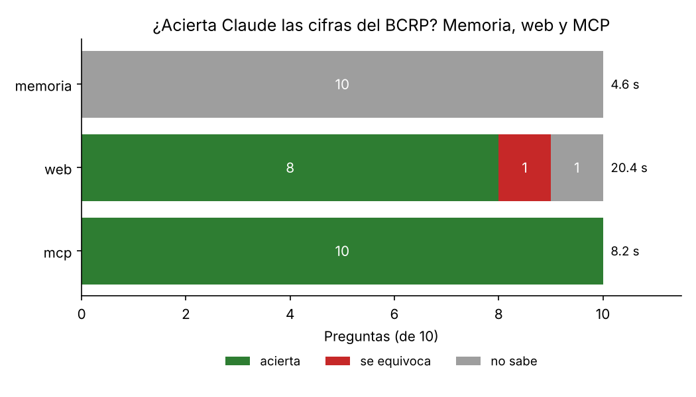

# ¿Inventa cifras Claude? Memoria, búsqueda web y un MCP del BCRP

## Qué construí

Armé un servidor MCP con FastMCP que se conecta a la API de estadísticas del BCRP. Tiene las tres herramientas base
(`buscar_series`, `serie` y `resumen`) y una que agregué yo, `ultimo_dato`. La pensé para preguntas del tipo «¿cuánto
está hoy el tipo de cambio?», donde el modelo no sabe qué mes o qué día ya está publicado. Devuelve el último dato, el
del año anterior, la variación entre ambos y el link de la fuente.

También tiene un recurso (`bcrp://serie/{codigo}`) con la ficha de cada serie y un prompt (`informe(tema)`) que arma
cinco viñetas con una cifra cada una. Lo más trabajoso fue normalizar las fechas, porque la API devuelve los meses
como `Ene.2025` o `Set.2026` y los días como `01.Oct.26`. Las 8 pruebas de `test_server.py` pasan sin tocar ese archivo.

## Mis dos preguntas

Agregué dos preguntas sobre series que no estaban en el archivo del curso:

- **Exportaciones totales FOB de agosto de 2026** (serie PN38714BM): 10,815.4 millones de US$.
- **Cotización promedio del oro (LME) en agosto de 2026** (serie PN01654XM): 4,411.15 US$ por onza troy.

Al principio busqué «exportaciones totales» y «oro», pero el buscador devolvía series que no eran (flujo de caja del
tesoro, producción minera por departamento). Con «exportaciones» y «cotizaciones oro» sí aparecieron las correctas. Los
dos valores los revisé en la tabla de la web del BCRP antes de ponerlos en `preguntas.csv`.

## Resultados

Corrí las 10 preguntas con Haiku usando `claude -p`. La corrida base, memoria contra MCP, está en
`resultados_base.csv`:

| Modo | Acierta | Se equivoca | No sabe | Segundos promedio |
|---|---|---|---|---|
| memoria | 0 | 0 | 10 | 7.9 |
| mcp | 10 | 0 | 0 | 13.4 |

Sin herramientas no acertó ninguna, pero me sorprendió que tampoco inventara: en las 10 puso `null` y explicó que no
tenía acceso a datos del INEI ni del BCRP. Tiene sentido, porque casi todas las preguntas son de 2026, después de lo que
el modelo aprendió. Con el MCP acertó las 10, y en cada respuesta citó el código de la serie, el periodo y el link de
la API. Tardó un poco más porque primero busca la serie y después la descarga.

### Experimento extra: contra la búsqueda web

Para el experimento extra agregué el modo web (`uv run evaluar.py --modos memoria web mcp`). Esta corrida quedó en
`resultados.csv` y es la del gráfico:

| Modo | Acierta | Se equivoca | No sabe | Segundos promedio |
|---|---|---|---|---|
| memoria | 0 | 0 | 10 | 4.6 |
| web | 8 | 1 | 1 | 20.4 |
| mcp | 10 | 0 | 0 | 8.2 |



Con la web acertó 8. El error fue el cobre: respondió 651 en vez de 689.70 porque tomó la cotización del cobre en la
LME (PN01652XM) y no el precio de exportación que usa la pregunta (PN38784BM). La cifra existe, pero es de otra serie,
y eso es justo lo que el MCP evita. En la tasa de referencia de setiembre respondió que no sabía: encontró una nota que
decía 4.25 %, pero no pudo abrirla para confirmarla. En varias de las que acertó citó a la prensa (Andina, Forbes, El
Comercio) en vez de al BCRP, y en promedio tardó más del doble que el MCP.

### Experimento extra: sin la opción de decir «no sé»

También probé quitar de la instrucción la frase «Si no puedes saberlo con certeza, pon valor null: no estimes.» Para no
editar el código cada vez, le agregué a `evaluar.py` la opción `--sin-salida` (y `--salida` para elegir el archivo):

```bash
uv run evaluar.py --sin-salida --modos memoria --salida resultados_sin_salida.csv
```

Esperaba que sin esa frase Claude inventara alguna cifra, pero no pasó: en las 10 siguió respondiendo `null`
(`resultados_sin_salida.csv`). En la `fuente` explica que no tiene acceso a internet ni a la API del BCRP y que no
quiere «dar un número de memoria como si fuera un dato oficial». Esto pasó incluso en las preguntas de 2025 (la
inflación de marzo y diciembre), que son anteriores a lo que aprendió. Con Haiku, al menos en este formato, la frase
no cambia el resultado.

### ¿El 10 de 10 fue suerte?

Repetí la corrida base dos veces más para ver si el resultado se mantiene:

| Corrida | Memoria: no sabe | MCP: acierta | Segundos MCP |
|---|---|---|---|
| 1 (`resultados_base.csv`) | 10 / 10 | 10 / 10 | 13.4 |
| 2 (`resultados_rep2.csv`) | 10 / 10 | 10 / 10 | 9.6 |
| 3 (`resultados_rep3.csv`) | 10 / 10 | 10 / 10 | 8.8 |

En total, el MCP acertó 30 de 30 y la memoria no dio ninguna cifra. Lo que sí varía es el tiempo, porque depende de
cuánto tarde en responder la API del BCRP.

## Dos cifras comprobadas a mano en la web del BCRP

| Cifra del MCP | Serie y periodo | Valor en la web | Tabla |
|---|---|---|---|
| Exportaciones FOB, 10,815.4 millones US$ | PN38714BM, agosto 2026 | 10,815 | [Balanza comercial - Exportaciones](https://estadisticas.bcrp.gob.pe/estadisticas/series/mensuales/resultados/PN38714BM/html/2026-6/2026-9/) |
| Oro LME, 4,411.15 US$ por onza troy | PN01654XM, agosto 2026 | 4,411 | [Cotizaciones - Oro LME](https://estadisticas.bcrp.gob.pe/estadisticas/series/mensuales/resultados/PN01654XM/html/2026-6/2026-9/) |

La web muestra estas series sin decimales, pero el valor coincide con el que devuelve mi servidor.

## Conclusión

Sin herramientas, Claude no conoce cifras recientes y lo reconoce en vez de inventar, incluso cuando le quité la
instrucción de no estimar. La
búsqueda web acierta casi siempre, pero es lenta y a veces toma una serie parecida o cita a un periódico en lugar de la
fuente oficial. El MCP fue el más exacto y siempre dejó el código y el link para verificar. Creo que vale la pena
construir un MCP cuando se consulta seguido la misma fuente de datos y se necesita la cifra exacta; para una pregunta
suelta, la búsqueda web basta.
